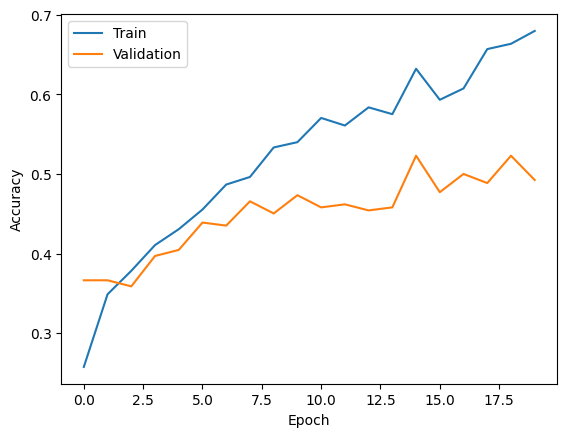
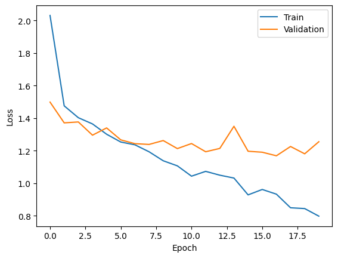
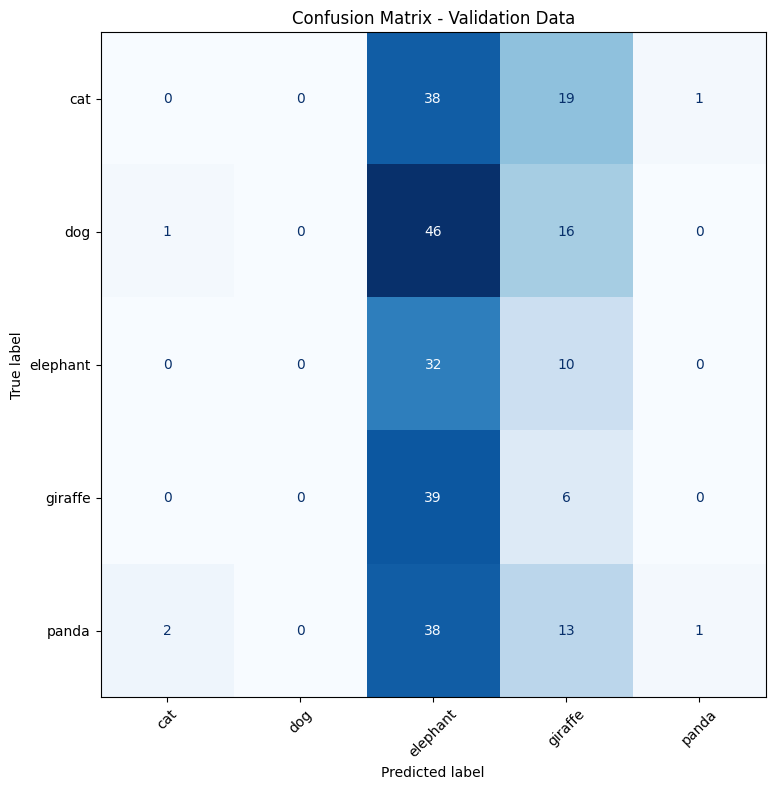
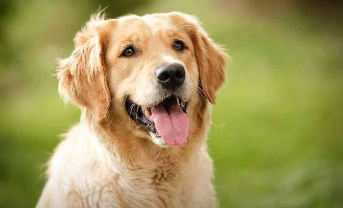
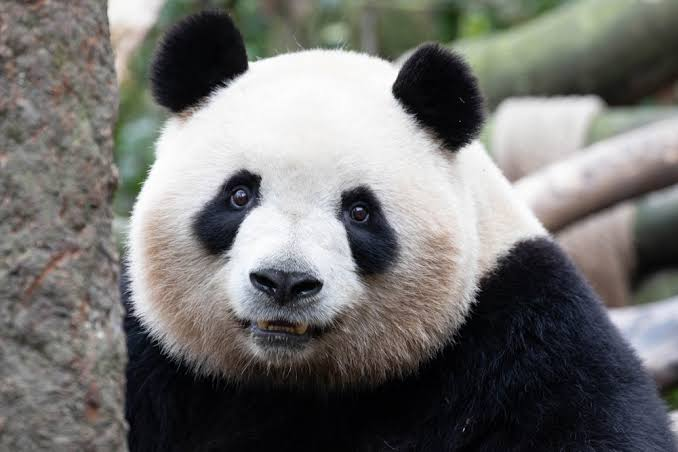

# Custom CNN — Animal Image Classification

A custom-built Convolutional Neural Network (CNN) using TensorFlow/Keras to classify animal images into **five categories: cat, dog, elephant, giraffe, and panda**. The notebook trains the network from a directory-based image dataset, evaluates it on a validation split, plots accuracy/loss curves, creates a confusion matrix, saves the model, and predicts labels for sample images.

> **Results status:** the notebook reports a final-epoch validation accuracy of **49.24%** and validation loss of **1.2548**. However, the saved confusion matrix implies **39 correct predictions out of 262 (14.89%)**. These figures conflict, so the evaluation should be rerun with a non-augmented validation pipeline before treating either result as definitive. Both recorded results are documented below rather than silently reconciled.

## Contents

- [Features](#features)
- [Tech stack](#tech-stack)
- [Project structure](#project-structure)
- [Dataset and preprocessing](#dataset-and-preprocessing)
- [CNN architecture](#cnn-architecture)
- [Training configuration](#training-configuration)
- [Recorded results](#recorded-results)
- [Confusion matrix](#confusion-matrix)
- [Sample predictions](#sample-predictions)
- [Run the notebook](#run-the-notebook)
- [Evaluation note and next steps](#evaluation-note-and-next-steps)

## Features

- Five-class animal image classification.
- Image resizing to **256 × 256** and pixel rescaling to **[0, 1]**.
- Training-time image augmentation: rotation, zoom, and horizontal flipping.
- A custom CNN with convolution, max-pooling, dense, and dropout layers.
- Accuracy and loss tracking across 20 epochs.
- Validation confusion matrix.
- Single-image prediction examples.
- Model export to an HDF5 `.h5` file.

## Tech stack

- Python
- TensorFlow / Keras
- OpenCV (`cv2`)
- NumPy
- Matplotlib
- scikit-learn
- Google Colab (notebook metadata indicates a **T4 GPU** runtime)

## Project structure

The README uses the following relative paths. Keep the input files already in your project and add the three generated result plots to `output/`.

```text
.
├── README.md
├── animals(1).ipynb
├── input/
│   ├── dog-1.jpg
│   └── panda.jpg
└── output/
    ├── accuracy.png
    ├── loss.png
    └── confusion_matrix.png
```

The notebook currently uses absolute Google Colab paths. Update those paths to match your own Drive or project folder before running it locally.

## Dataset and preprocessing

The notebook found the following number of images:

| Split | Images | Classes |
|---|---:|---:|
| Training | 1,052 | 5 |
| Validation | 262 | 5 |
| **Total** | **1,314** | **5** |

The class names, in the directory generator's index order, are:

`cat` · `dog` · `elephant` · `giraffe` · `panda`

The generator resizes images to `256 × 256`, rescales pixel values by `1/255`, and configures these augmentation settings:

| Augmentation | Setting |
|---|---:|
| Rotation range | 15° |
| Zoom range | 0.15 |
| Horizontal flip | Enabled |
| Validation split | 20% |

**Important:** the original notebook passes the same augmented `ImageDataGenerator` to both training and validation. That means validation images are augmented too. See [Evaluation note and next steps](#evaluation-note-and-next-steps).

## CNN architecture

The model is a Keras `Sequential` network with an input shape of `(256, 256, 3)`.

| Order | Layer | Configuration | Output role |
|---:|---|---|---|
| 1 | Input | `256 × 256 × 3` | RGB image tensor |
| 2 | Conv2D | 64 filters, `3 × 3`, ReLU, `same` padding | Low-level features |
| 3 | Conv2D | 64 filters, `3 × 3`, ReLU, `same` padding | Feature extraction |
| 4 | MaxPooling2D | `2 × 2`, stride 2 | Downsampling |
| 5 | Conv2D | 128 filters, `3 × 3`, ReLU, `same` padding | Deeper features |
| 6 | Conv2D | 128 filters, `3 × 3`, ReLU, `same` padding | Feature extraction |
| 7 | MaxPooling2D | `2 × 2`, stride 2 | Downsampling |
| 8 | Flatten | — | Converts feature maps to a vector |
| 9 | Dense | 512 units, ReLU | Classification features |
| 10 | Dropout | `0.5` | Regularization during training |
| 11 | Dense | 5 units, Softmax | Class probabilities |

The model has approximately **268.7 million trainable parameters**, mostly due to the `Flatten → Dense(512)` connection. This makes the current architecture memory-intensive; replacing `Flatten` with `GlobalAveragePooling2D` is a potential model-size reduction to test in a future experiment, not a result from the current notebook.

## Training configuration

| Setting | Value |
|---|---|
| Optimizer | Adam |
| Learning rate | `0.001` |
| Loss function | Categorical cross-entropy |
| Tracked metric | Accuracy |
| Epochs | 20 |
| Validation source | 20% directory split |
| Saved model path in notebook | `/content/drive/MyDrive/Deep Learning/animals.h5` |

## Recorded results

### Final epoch metrics printed by the notebook

| Metric | Recorded value |
|---|---:|
| Final validation accuracy | **49.24%** |
| Final validation loss | **1.2548** |
| Epochs completed in the plotted history | **20** |

These are the values printed from `history.history["val_accuracy"][-1]` and `history.history["val_loss"][-1]`. They are **validation metrics**, not results from an independent test set.

### Accuracy by epoch



### Loss by epoch



The plots show training accuracy increasing across the run, while validation accuracy fluctuates. Training loss trends downward; validation loss fluctuates and ends at the reported `1.2548`.

## Confusion matrix

The notebook's saved validation confusion matrix is shown below. Rows are the **true labels** and columns are the **predicted labels**.



| True \\ Predicted | Cat | Dog | Elephant | Giraffe | Panda | Support |
|---|---:|---:|---:|---:|---:|---:|
| **Cat** | 0 | 0 | 38 | 19 | 1 | 58 |
| **Dog** | 1 | 0 | 46 | 16 | 0 | 63 |
| **Elephant** | 0 | 0 | 32 | 10 | 0 | 42 |
| **Giraffe** | 0 | 0 | 39 | 6 | 0 | 45 |
| **Panda** | 2 | 0 | 38 | 13 | 1 | 54 |
| **Predicted total** | **3** | **0** | **193** | **64** | **2** | **262** |

From this matrix, the diagonal contains `0 + 0 + 32 + 6 + 1 = 39` correct predictions. Therefore, the matrix-derived accuracy is:

`39 / 262 ≈ 14.89%`

This does **not** match the final-epoch validation accuracy printed by the training history (**49.24%**). The result should be considered unresolved until the validation setup and notebook execution order are corrected and the evaluation is repeated.

## Sample predictions

The notebook's two image-inference cells printed these results:

| Input image in the notebook | Predicted label |
|---|---|
| `dog-1.jpg` | **Dog** |
| `panda-1.jpg` | **Panda** |





**Filename note:** the notebook currently reads `/content/panda-1.jpg`, whereas the project structure above uses `input/panda.jpg`, as specified for this project. Make the inference path match the actual filename before running the cell. These two successful examples are illustrative only and do not establish overall model accuracy.

## Run the notebook

1. Open `animals.ipynb` in Google Colab or Jupyter.
2. Install the required packages if they are not already available:

   ```bash
   pip install tensorflow opencv-python numpy matplotlib scikit-learn
   ```

3. Point `dataset_path` to the root directory containing one folder per class (`cat/`, `dog/`, `elephant/`, `giraffe/`, and `panda/`).
4. Run the notebook cells in order to load the data, build and train the model, save the model, generate the confusion matrix, print the metrics, and run the sample predictions.
5. Keep the generated result images in `output/` so the charts in this README render on GitHub.

## Evaluation note and next steps

Before publishing the metrics as final, use separate generators for training and validation. Apply random augmentation only to training; validation should use deterministic preprocessing, such as rescaling without rotation, zoom, or flipping. Then rerun training/evaluation cells in order and regenerate all output plots and the confusion matrix.

Also consider:

- Saving plots with `plt.savefig("output/accuracy.png", bbox_inches="tight")`, and likewise for loss and the confusion matrix, instead of only displaying them.
- Using a `GlobalAveragePooling2D` layer before the classifier to reduce the very large dense layer; retrain and compare rather than assuming accuracy will improve.
- Reporting a separate test-set score if a held-out test set is available.

**Current conclusion:** the notebook demonstrates the complete custom-CNN workflow and correctly predicts the two shown example images, but its recorded evaluation outputs disagree. Re-evaluation is needed before presenting a single definitive model accuracy.

CREATE by Sajjad Saljoughi ❤
